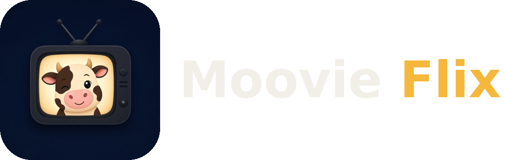

<div align="center">

  

  <p>
    A free, open-source media app for the TV you already own.
    <br />
    Bring your own sources, including movie folders you own. Moovie Flix turns them into a library with artwork, ratings, subtitles, and your place saved.
  </p>

  [GitHub](https://github.com/NuvioMedia)

</div>

> **Fork notice:** Moovie Flix is a fork of [NuvioTV](https://github.com/MoovieFlixMedia/NuvioTV) by the Nuvio developers,
> licensed under the GNU General Public License v3.0. This fork keeps the original license and copyright notices.
> Changes in this fork: Moovie Flix branding and a local folder library ("My Movies").

## My Movies (local library)

Open **Library** and use the **My Movies** row. Add folders you own with the Android folder picker
(device storage, USB drives, or network shares exposed by a documents provider) or add an HTTP directory
listing URL. Moovie Flix scans for video files, reads the title and year from file names, and plays them
with the built-in player.

## Build from source

```bash
git clone https://github.com/NuvioMedia
./gradlew :app:assembleFullDebug
```

Built with Kotlin, Jetpack Compose, TV Material 3, and Media3. Development requires Android Studio, a JDK, and the Android SDK.

## License

[GNU General Public License v3.0](./LICENSE)